# Modelo de dados — schema atual

Gerado a partir das migrações Flyway **V1–V16** (`api/src/main/resources/db/migration/`), a 2026-10-23.
As migrações são a única fonte de verdade do schema (`ddl-auto: validate`); este documento é só um mapa.
A versão anterior deste ficheiro era o desenho inicial (tabelas `claims`, `transactions`, `waitlist_leads`, …) e foi substituída.

Valores monetários em `NUMERIC(12,2)` (Kz; taxa e retenções em kwanzas inteiros). Datas de aluguer em `DATE`; instantes em `TIMESTAMPTZ`.
Tabelas **append-only** (trigger bloqueia `UPDATE`/`DELETE`): `ledger_entries`, `kyc_decisions`, `audit_logs`.
Ficheiros (KYC, fotos, checklists, problemas) ficam no Backblaze B2; a base de dados guarda só a `storage_key`.

```mermaid
erDiagram
    PROFILES ||--|| ACCOUNTS : "tem"
    PROFILES ||--o{ REFRESH_TOKENS : "sessões"
    PROFILES ||--o{ KYC_VERIFICATIONS : "submete"
    KYC_VERIFICATIONS ||--o{ KYC_DOCUMENTS : "ficheiros"
    KYC_VERIFICATIONS ||--o{ KYC_DECISIONS : "histórico"
    PROFILES ||--o{ ITEMS : "é dono"
    CATEGORIES ||--o{ ITEMS : "classifica"
    CATEGORIES ||--o{ CATEGORIES : "subcategoria"
    ITEMS ||--o{ ITEM_PHOTOS : "fotos"
    ITEMS ||--o{ ITEM_AVAILABILITY : "datas indisponíveis"
    ITEMS ||--o{ BOOKINGS : "reservado em"
    PROFILES ||--o{ BOOKINGS : "aluga / disponibiliza"
    BOOKINGS ||--o| CONTRACTS : "contrato (1:1)"
    BOOKINGS ||--o{ PAYMENTS : "tentativas (1:N)"
    BOOKINGS ||--o| DEPOSITS : "caução (1:1)"
    BOOKINGS ||--o{ CHECKLISTS : "entrega e devolução"
    CHECKLISTS ||--o{ CHECKLIST_PHOTOS : "fotos"
    BOOKINGS ||--o{ INCIDENT_REPORTS : "problemas"
    INCIDENT_REPORTS ||--o{ INCIDENT_PHOTOS : "fotos"
    ACCOUNTS ||--o{ LEDGER_ENTRIES : "movimentos"
    BOOKINGS ||--o{ LEDGER_ENTRIES : "origina"
    PAYMENTS ||--o{ LEDGER_ENTRIES : "liquida"
    PROFILES ||--o{ NOTIFICATIONS : "recebe"
    BOOKINGS ||--o{ NOTIFICATIONS : "sobre"
    PROFILES ||--o{ AUDIT_LOGS : "executa"

    PROFILES {
        uuid id PK
        text full_name
        text phone UK "login + OTP"
        text email UK "opcional"
        text password_hash
        text google_id UK
        varchar role "OWNER | RENTER | BOTH | ADMIN"
        varchar account_type "INDIVIDUAL | BUSINESS (V8)"
        boolean is_verified "telefone confirmado — NÃO é KYC"
        numeric rating_avg
    }
    ACCOUNTS {
        uuid id PK
        uuid profile_id FK
        numeric available_balance
        numeric held_balance
        varchar currency "AOA"
    }
    KYC_VERIFICATIONS {
        uuid id PK
        uuid profile_id FK "1 não recusada por perfil"
        varchar account_type
        varchar status "PENDING | IN_REVIEW | APPROVED | REJECTED | INFO_REQUESTED"
        timestamptz submitted_at
        uuid reviewed_by FK
        text rejection_reason
        text info_request_note
    }
    KYC_DOCUMENTS {
        uuid id PK
        uuid kyc_id FK
        varchar document_type "BI_FRONT | BI_BACK | SELFIE | NIF_DOCUMENT | BUSINESS_DOCUMENT"
        text storage_key UK
        varchar content_type
        bigint size_bytes
    }
    KYC_DECISIONS {
        uuid id PK
        uuid kyc_id FK
        uuid actor_id FK "admin ou o próprio (RESUBMIT)"
        varchar action "START_REVIEW | APPROVE | REJECT | REQUEST_INFO | RESUBMIT"
        text note
    }
    ITEMS {
        uuid id PK
        uuid owner_id FK
        uuid category_id FK
        varchar title
        varchar condition "NEW | LIKE_NEW | GOOD | FAIR"
        numeric price_per_day
        numeric deposit_amount
        varchar status "ACTIVE | INACTIVE | SUSPENDED | DELETED"
    }
    ITEM_PHOTOS {
        uuid id PK
        uuid item_id FK
        text photo_url "URL externa antiga"
        text storage_key UK "fotos novas (V11)"
        int position "0 = capa"
    }
    BOOKINGS {
        uuid id PK
        uuid item_id FK
        uuid renter_id FK
        uuid owner_id FK
        date start_date
        date end_date
        numeric total_price "aluguer"
        numeric deposit_amount
        varchar status "PENDING_OWNER | ACCEPTED | ACTIVE | IN_PROGRESS | RETURNED | COMPLETED | CANCELLED_* | DISPUTED"
        text renter_message
        text owner_note
    }
    CONTRACTS {
        uuid id PK
        uuid booking_id FK "UK"
        varchar version "v1-rascunho"
        text body "imutável (trigger)"
        varchar body_sha256
        timestamptz owner_accepted_at "= aceitar o pedido"
        timestamptz renter_accepted_at "antes de pagar"
    }
    PAYMENTS {
        uuid id PK
        uuid booking_id FK
        uuid renter_id FK
        varchar method "REFERENCE | MANUAL"
        varchar provider "SIMULATED | MANUAL | EMIS (futuro)"
        varchar entity
        varchar reference
        numeric rental_amount
        numeric service_fee "8%"
        numeric deposit_amount
        numeric amount "= soma dos três"
        varchar status "AWAITING_PAYMENT | CONFIRMED | EXPIRED | CANCELLED | FAILED"
        timestamptz expires_at
    }
    DEPOSITS {
        uuid id PK
        uuid booking_id FK "UK"
        numeric amount
        varchar status "HELD | RELEASED | WITHHELD"
        numeric withheld_amount "vai para o dono"
        text reason "obrigatório se WITHHELD"
        uuid decided_by FK
    }
    CHECKLISTS {
        uuid id PK
        uuid booking_id FK
        varchar type "DELIVERY | RETURN (1 de cada por reserva)"
        uuid created_by FK
        text notes
        uuid confirmed_by FK "sempre a outra parte"
        timestamptz confirmed_at
    }
    CHECKLIST_PHOTOS {
        uuid id PK
        uuid checklist_id FK
        text storage_key UK
        int position
    }
    INCIDENT_REPORTS {
        uuid id PK
        uuid booking_id FK
        uuid reporter_id FK
        varchar type "DAMAGE | LOSS | THEFT | OTHER"
        text description
        varchar status "OPEN | RESOLVED"
        text resolution_note
        uuid resolved_by FK
    }
    INCIDENT_PHOTOS {
        uuid id PK
        uuid incident_id FK
        text storage_key UK
    }
    LEDGER_ENTRIES {
        uuid id PK
        uuid account_id FK
        uuid booking_id FK
        uuid payment_id FK "V7"
        varchar type "TOPUP | SERVICE_FEE | HOLD | DEPOSIT_HOLD | HOLD_RELEASE | DEPOSIT_RETURN | DEPOSIT_FORFEIT | PAYMENT_DEBIT | PAYMENT_CREDIT | ADJUSTMENT"
        numeric amount "> 0"
        numeric balance_after
    }
    NOTIFICATIONS {
        uuid id PK
        uuid profile_id FK
        varchar type
        varchar title
        text body
        varchar link_path "caminho no frontend"
        uuid booking_id FK
        timestamptz read_at
        varchar email_status "PENDING | SENT | FAILED | SKIPPED"
    }
    AUDIT_LOGS {
        uuid id PK
        uuid actor_id FK "null = sistema"
        varchar action
        varchar entity_type "BOOKING | KYC | ACCOUNT | INCIDENT"
        uuid entity_id
        text reason
        jsonb metadata "sem dados pessoais"
    }
```

Tabelas auxiliares sem relações relevantes para o negócio: `otp_codes` (códigos OTP com hash), `google_pending_signups` (registo Google à espera do telefone), `oauth_login_codes` (código de 60 s do login Google, só o hash), `item_availability` (ainda sem endpoints — ver `BACKEND_GAPS.md` #8).

## Migrações

| Versão | O que cria |
|---|---|
| V1 | `profiles`, `accounts`, `otp_codes`, `refresh_tokens`, função `set_updated_at()` |
| V2 | `categories`, `items`, `item_photos`, `item_availability` |
| V3 | `google_pending_signups` |
| V4 | `bookings` |
| V5 | `ledger_entries` (append-only) |
| V6 | `payments` + tipos `TOPUP`/`SERVICE_FEE` no ledger |
| V7 | `ledger_entries.payment_id` |
| V8 | KYC: `kyc_verifications`, `kyc_documents`, `kyc_decisions`; `profiles.account_type` |
| V9 | `notifications` |
| V10 | `audit_logs` (append-only) |
| V11 | `item_photos.storage_key` (fotos no B2) |
| V12 | `contracts` |
| V13 | estados `IN_PROGRESS`/`RETURNED`; `checklists`, `checklist_photos`; tipos novos de notificação |
| V14 | `deposits` (com backfill a partir do ledger) |
| V15 | `incident_reports`, `incident_photos` |
| V16 | `oauth_login_codes` (código de uso único do login Google) |
